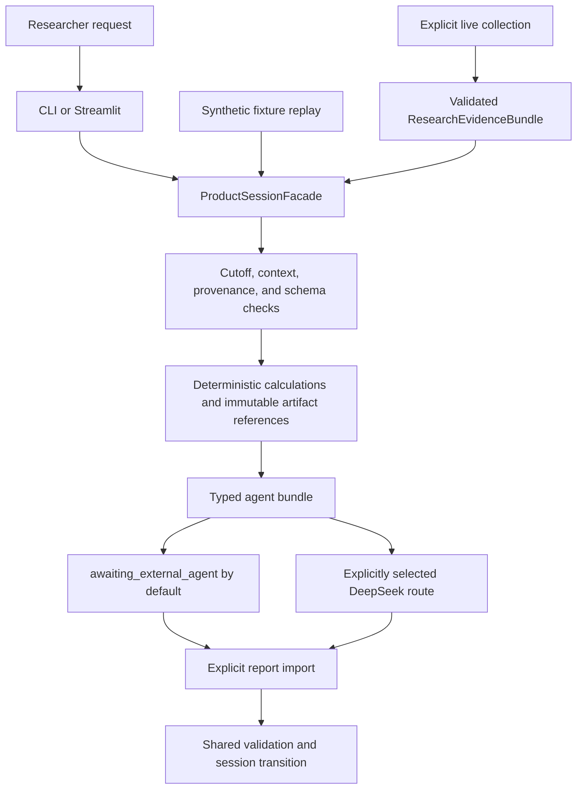

# EventLens

**Research and decision support for earnings events.**

EventLens is intended to help an analyst get oriented before and after a
company event—especially an earnings call—by bringing together the evidence
that can shape the market's reaction. The product combines company and
earnings context, news, prior-event history, market behavior, and quantitative
reaction analysis. It keeps the qualitative case (what may matter and why)
connected to quantitative evidence (what changed, by how much, and over what
period), so an analyst can examine both supporting and opposing signals.

The broader product goal is a readable, cutoff-aware earnings brief: what is
known, what is changing, how the stock has been behaving, what prior events
can and cannot tell us, and which scenarios or risks deserve attention. Price
momentum and trading velocity—the pace and participation behind a move—belong
in that picture. A conditional, policy-governed trading stance may be useful
when the workflow has the evidence and operator policy to support one; it
should be explicit about uncertainty and abstain when it cannot support a
stance.

For a concrete example of the intended reader experience, see the
[illustrative NVIDIA pre-earnings brief](docs/examples/nvda-fy2027-q3-pre-earnings-brief.md).
It uses paraphrased public issuer and SEC facts, includes a historical
directional read but no Buy/Sell/Hold rating, and clearly marks the market-data
and live-run limits of the original example.

This public repository is an alpha source preview of that system, not a
finished end-to-end earnings brief generator. It currently includes
cutoff-aware news signals, historical context cards, event-reaction and other
deterministic calculations, and a technical projection with latest close and
prior 5- and 20-session returns. Those return fields provide basic trend
context; this preview does not implement a dedicated trading-velocity signal
or a complete momentum methodology. Live collection, synthesis, review, and
publication still require operator work. See [what works today](#what-works-todayand-the-boundary)
and the [implementation status](docs/guide/implementation-status.md) for the
precise boundary.

EventLens is **research software**, not a broker or autonomous trading system.
It does not place or simulate trades. Any proposed stance in an agent-authored
report is conditional research output for independent human review, not
personalized investment advice or an instruction to trade.

Maintainer: [@taom88](https://github.com/taom88). For project questions and
issues, use the GitHub issue tracker.

## Start here

This repository is an alpha source preview. The easiest way to understand it is
to run the synthetic demo, then follow the guides for the part you want to
inspect:

1. Install the package and run the [key-free demo](#quick-start).
2. Read the [first-time reader’s guide](docs/guide/README.md) for the product
   model, workflow, and documentation map.
3. Use the [demo runbook](docs/demo-runbook.md) to inspect the UI journey and
   the artifacts it creates.
4. If you are reading the code, start with the
   [repository map](docs/guide/repository-map.md) and
   [current architecture](docs/architecture.md).

The guide explains which parts are working paths today and which end-to-end
stages remain incomplete. The demo is synthetic; it is not a live company
analysis.

## Quick start

Requires Python 3.11 or later. The demo runs from the bundled synthetic fixture
without API keys, provider calls, model calls, or network access.

```bash
python -m venv .venv
source .venv/bin/activate
python -m pip install .
eventlens demo
```

The command prints a small JSON receipt. A successful run reports
`"status": "validated"`, three context cards, zero provider calls, and zero
model calls. All records are synthetic. The fixture is useful for checking the
package and tracing the workflow; it is not a quality benchmark for live
research.

To open the local Streamlit interface:

```bash
eventlens app
```

For a guided five-minute tour, follow [the D0 fixture runbook](docs/demo-runbook.md).

## How EventLens can inform an earnings decision

Earnings reactions are shaped by more than whether reported results beat an
estimate. Analysts may need to weigh the change in guidance, business
fundamentals, new information in the news, expectations already reflected in
the price, price momentum and participation, and how the stock behaved around
comparable prior events. EventLens is being built to make those inputs
inspectable together rather than collapse them into an unexplained score.

| Research question | Evidence or analysis EventLens is designed to bring together |
|---|---|
| What is the event, and what information was available beforehand? | Event identity, a frozen information cutoff, source timestamps, and eligible prior-event context |
| What changed in the company or its outlook? | Earnings and company evidence, consensus or management guidance when supplied, with provenance and missing fields visible |
| What is the news saying, and how consistent is it? | Classified, cutoff-aware news signals, including tone, recency, relevance, breadth, topic mix, and conflicting coverage |
| What has the market been doing into the event? | The current preview carries latest close and prior 5- and 20-session returns; fuller momentum and trading-velocity measures remain unfinished work |
| What happened after comparable past events? | Deterministic event-reaction statistics with sample size, benchmark, horizon, and limitations where available |
| What might the evidence imply? | A bounded qualitative synthesis can organize thesis, counter-thesis, scenarios, uncertainty, and cited evidence; an optional stance requires the applicable policy and review |

The goal is a research aid that helps a person decide what deserves attention
and what risks or conditions would change their view. The system should make
the evidence and assumptions visible, including disagreement between the
qualitative thesis and quantitative signals. Historical association is not
causation, and a reaction statistic is not a forecast.

### What the current preview actually runs

The public synthetic demo is the most complete packaged journey, but it uses
synthetic records and does not generate a live investment brief. The codebase
also contains live-provider adapters, typed evidence assembly, cutoff
validation, deterministic news aggregation, price-return features, historical
context workflows, event studies, and an external-agent report boundary.
These are building blocks with separate configuration and review steps; they
are not yet one dependable, automated pipeline from ticker and earnings date
to a publication-ready brief.

The recommendation boundary is deliberately narrow. EventLens does not own a
default action vocabulary or decide what a user should trade. The codebase
retains a legacy version-1 agent-report schema with fixed action labels for
compatibility; that is not a product default or proof of a complete
recommendation workflow. New recommendation behavior should require a supplied,
versioned operator policy, preserve the analysis, and abstain when no usable
policy applies. That policy-governed path is not established as a complete
end-to-end feature in this preview. See the
[decision-record guide](docs/decisions/README.md) for context on these
contracts.

## What EventLens does

EventLens is designed as the research and validation layer around an analyst's
chosen AI agent. A user can fork the repository, configure their own data
providers and credentials, and connect an agent or orchestration harness that
can consume EventLens's typed handoff and return its versioned report format.
The agent supplies the semantic analysis; EventLens prepares the evidence,
owns deterministic calculations, and checks the returned report. In the
default external-agent route, the operator carries the bundle to their chosen
agent and imports its response. This is not yet a one-click, universal agent
plug-in; the optional direct model route is separately configured.

The intended research-to-brief flow is:

1. Establish the target event and an explicit information cutoff.
2. Check that prior-event context and evidence were available before that
   cutoff and are eligible for the requested use.
3. Assemble a versioned research session from eligible company and earnings
   evidence, news, market/technical inputs, and prior-event context when those
   inputs are supplied; missing or unavailable evidence stays explicit.
4. Keep source receipts, availability times, provenance, and checksums
   attached to the typed inputs, and calculate canonical financial metrics
   deterministically with units, periods, and limitations.
5. Export an immutable, cutoff-bounded evidence bundle and report schema for
   the selected agent or harness to interpret.
6. Validate the agent's returned report against the original bundle before
   accepting it into the session.
7. Make the validated analysis available as a human-readable report: cited
   claims, thesis and counter-thesis, scenarios, reaction forecast, optional
   recommendation or abstention, valuation zones when supported, and explicit
   uncertainty and warnings.

The report is meant to give an analyst a useful, evidence-linked view of the
event—not just a news summary or a bare buy/sell label. Which sections can be
filled depends on the supplied evidence and the report's validated fields. A
stance is conditional research output, not a trade instruction; without a
usable operator policy, the system should preserve the analysis and abstain.
The current public preview has the session, handoff, validation, and basic
Markdown-rendering components, but it does not yet compose every live data
source into a complete publication-ready brief automatically.

The key separation is **evidence and facts first; interpretation second**.
Provider data and model prose do not become canonical facts just because they
appear in a report. The application validates their identity, timing,
provenance, citations, and schema before using them.

To use a separately operated agent, start with the
[external-agent operator contract](docs/external-agent-operator.md), which
describes the bundle, prompt, report schema, and explicit import. The
versioned schema is at
[`schemas/eventlens.external_agent.v1.schema.json`](schemas/eventlens.external_agent.v1.schema.json).
The repo has reusable pieces for this handoff, but it does **not** yet have a
complete, polished earnings-brief skill or template: `src/eventlens/agents/skills.py`
contains prompt-level capabilities for EventLens's own interpreter, and
`src/eventlens/agents/external_rendering.py` renders validated report fields
into basic Markdown. Neither is a standalone, agent-agnostic brief package.



The diagram shows the intended handoff boundary, not a claim that every live
stage is available as one turnkey flow. The current live collection and
review/publishing journey is incomplete; see
[what is implemented and what remains](docs/guide/implementation-status.md).

## Product decisions that shape the code

- **Time is part of evidence.** Pre-event inputs must respect the frozen
  information cutoff. Later prices, news, or outcomes cannot silently enter
  pre-event context.
- **Calculations are deterministic.** EventLens code owns numeric facts,
  financial calculations, schema validation, checksums, and state transitions.
  A model may interpret bounded evidence; it does not replace the calculations.
- **Missing data stays visible.** Unknown, unavailable, or incomparable values
  carry explicit reasons. The system should not invent a proxy and present it
  as an observed fact.
- **The model handoff is explicit.** By default, EventLens exports a typed
  bundle and pauses for a human to run and import an external agent’s report.
  An explicitly selected DeepSeek route uses the same validation contract;
  failures do not cause a silent provider or route switch.
- **Rights and provenance are first-class.** Evidence is used only within its
  declared source, cutoff, and retention boundary. A citation or checksum
  records lineage; it does not grant permission to redistribute source data.
- **Human review remains responsible for decisions.** The project preserves
  evidence and analysis. It does not execute trades or replace an operator’s
  judgment.

See [the product decisions guide](docs/guide/product-decisions.md) for the
rationale and the contracts behind these choices.

## What works today—and the boundary

| Area | Available in this preview | Boundary to keep in mind |
|---|---|---|
| Synthetic demo | Deterministic fixture replay with readable prior context, a baseline, an external-agent pause/import, and restart checks | Uses only synthetic data; it does not establish live accuracy or provider readiness |
| Research request | Repository-backed product session from a validated evidence bundle; typed readiness and blocked states | Operators must prepare eligible evidence; this is not an automatic universal data-to-brief service |
| Evidence collection | Provider adapters and a manifest/config-gated collection script | Live use needs the operator’s accounts, data rights, current configuration, and explicit authorization; one adapter smoke is not a complete live run |
| Model interpretation | Default external-agent export/import; explicit direct DeepSeek route behind the same validation boundary | EventLens does not launch an external agent automatically and does not silently fall back between routes |
| Interface | CLI and local Streamlit interface over the product-session service | Interface does not make the incomplete research, review, QA, and publication stages complete |
| Learning and evaluation | Deterministic checks, evaluation schemas, synthetic context-card cases, and offline/shadow workflow | Current public fixtures are not a human-scored quality benchmark; no learned improvement is claimed |
| Deployment storage | Local SQLite for demo/test and an owner-configured Supabase repository for durable records | Each deployment needs its own infrastructure and private artifact storage; the repository includes no shared credentials or hosted project |

For exact limitations and current release evidence, read the
[preview notes](docs/public-release/README.md) and
[snapshot acceptance record](docs/public-release/acceptance-note.md).

## Who this repository is for

- **Researchers and analysts** who want to inspect a cutoff-aware, evidence-
  preserving workflow and its synthetic example.
- **Engineers** who want to understand the boundaries between product
  orchestration, providers, calculations, model interpretation, persistence,
  and evaluation.
- **Reviewers and contributors** who need to see which product decisions are
  enforced by code, which decisions are documented, and what is still
  incomplete.

It is not a drop-in financial-data feed, a stock screener, a backtesting
platform, or a turnkey service. Provider and model integrations are optional
components with their own accounts, costs, terms, and operational limits.

## Reading paths

- **New to EventLens:** [Start here](docs/guide/README.md) →
  [Product model](docs/guide/product-model.md) →
  [Implementation status](docs/guide/implementation-status.md).
- **Understanding design choices:**
  [Product decisions](docs/guide/product-decisions.md) →
  [Architecture](docs/architecture.md) →
  [decision records](docs/decisions/).
- **Trying the public demo:** [Quick start](#quick-start) →
  [demo runbook](docs/demo-runbook.md) →
  [synthetic output and preview limits](docs/public-release/README.md).
- **Working with your own data:**
  [live-provider setup](docs/public-release/live-provider-setup.md) →
  [provider strategy](docs/provider-strategy.md) →
  [data policy](DATA_POLICY.md).
- **Inspecting model or persistence boundaries:**
  [external-agent operator contract](docs/external-agent-operator.md) →
  [agent runtime](docs/agent-runtime.md) →
  [storage](docs/storage.md).
- **Reviewing evaluation claims:**
  [learning and evaluation](docs/learning-and-evaluation.md) →
  [context-card rubric](docs/evaluations/context-card-rubric-v0.1.json) →
  [evaluation limitations](docs/guide/implementation-status.md#evaluation-and-learning).

## Configuration and live data

The demo needs no configuration. Provider-backed collection is separate and
uses the operator’s own credentials in a local `.env` file or process
environment. Do not commit `.env`, keys, provider payloads, or private run
artifacts. Start with the [live-provider setup guide](docs/public-release/live-provider-setup.md)
and read the relevant provider’s current terms before collection.

Check configuration without printing secret values:

```bash
eventlens config-check
eventlens provider-plan
```

Deployment storage also belongs to the operator. See
[storage configuration](docs/storage.md) and
[Supabase setup](docs/supabase-setup.md).

## Development

```bash
python -m pip install -e '.[dev]'
python -m pytest -q
python -m compileall -q src tests
git diff --check
```

Credentialed provider calls are not part of ordinary CI. Use synthetic or
independently redistributable fixtures in tests and pull requests. Read
[contributing](CONTRIBUTING.md) before opening a change.

## License, data, and security

EventLens source code is licensed under Apache-2.0. Third-party packages retain
their own licenses; the [dependency inventory](docs/public-release/dependency-license-inventory.json)
and [review record](docs/public-release/dependency-license-review.md) cover the
current non-vendored source/wheel boundary. They are engineering records, not
legal clearance. A combined/container distribution needs a separate
platform-specific dependency and notice review.

The runnable demo uses synthetic data. The repository also includes one
curated, paraphrased case study based on linked public issuer and SEC
disclosures; it excludes provider receipts, third-party market-price series,
news-aggregator material, transcript text, and Buy/Sell/Hold ratings. Provider
data, news, transcripts, and other external content are governed by the
operator’s rights and provider terms; EventLens provenance does not grant
redistribution rights.
Review the [data policy](DATA_POLICY.md), [privacy notice](PRIVACY.md),
[security policy](SECURITY.md), and [disclaimer](DISCLAIMER.md) before use.
