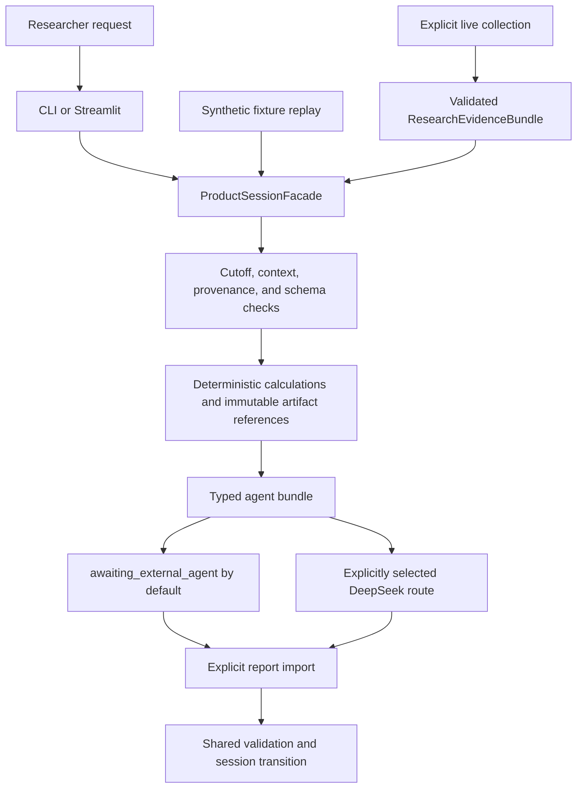

# EventLens

**A cutoff-aware research workflow for understanding company events.**

EventLens helps a researcher assemble a reviewable record around a scheduled
company event—especially an earnings release. It brings historical context,
source-backed evidence, deterministic calculations, and optional model
interpretation into one reproducible workflow. It is designed to make clear
what was known at a point in time, where each input came from, what the system
calculated, and what is still uncertain.

EventLens is **research software**, not a broker, trading system, or finished
investment product. It does not place or simulate trades. Its outputs require
independent human review and are not investment advice.

Maintainer: [@taom88](https://github.com/taom88). For project questions and
issues, use the GitHub issue tracker.

## Start here

This repository is an alpha source preview. The easiest way to understand it is
to run the synthetic demo, then follow the guides for the part you want to
inspect:

1. Install the package and run the [key-free demo](#quick-start).
2. Read the [first-time reader’s guide](docs/guide/README.md) for the product
   model, workflow, and documentation map.
3. Use the [demo runbook](docs/demo-runbook.md) to inspect the UI journey and
   the artifacts it creates.
4. If you are reading the code, start with the
   [repository map](docs/guide/repository-map.md) and
   [current architecture](docs/architecture.md).

The guide explains which parts are working paths today and which end-to-end
stages remain incomplete. The demo is synthetic; it is not a live company
analysis.

## Quick start

Requires Python 3.11 or later. The demo runs from the bundled synthetic fixture
without API keys, provider calls, model calls, or network access.

```bash
python -m venv .venv
source .venv/bin/activate
python -m pip install .
eventlens demo
```

The command prints a small JSON receipt. A successful run reports
`"status": "validated"`, three context cards, zero provider calls, and zero
model calls. All records are synthetic. The fixture is useful for checking the
package and tracing the workflow; it is not a quality benchmark for live
research.

To open the local Streamlit interface:

```bash
eventlens app
```

For a guided five-minute tour, follow [the D0 fixture runbook](docs/demo-runbook.md).

## What EventLens does

An event research run should preserve both its answer and the path used to
reach it. At a high level, EventLens:

1. Establishes the target event and an explicit information cutoff.
2. Checks that prior-event context and evidence were available before that
   cutoff and are eligible for the requested use.
3. Keeps source receipts, missing fields, provenance, and checksums attached to
   typed research inputs.
4. Calculates canonical financial metrics in deterministic code, with their
   units, periods, and limitations.
5. Creates a versioned research session and exports a bounded, typed handoff
   when model interpretation is requested.
6. Validates a returned report against the original bundle before accepting it
   into the session.

The key separation is **evidence and facts first; interpretation second**.
Provider data and model prose do not become canonical facts just because they
appear in a report. The application validates their identity, timing,
provenance, citations, and schema before using them.



The diagram shows the intended handoff boundary, not a claim that every live
stage is available as one turnkey flow. The current live collection and
review/publishing journey is incomplete; see
[what is implemented and what remains](docs/guide/implementation-status.md).

## Product decisions that shape the code

- **Time is part of evidence.** Pre-event inputs must respect the frozen
  information cutoff. Later prices, news, or outcomes cannot silently enter
  pre-event context.
- **Calculations are deterministic.** EventLens code owns numeric facts,
  financial calculations, schema validation, checksums, and state transitions.
  A model may interpret bounded evidence; it does not replace the calculations.
- **Missing data stays visible.** Unknown, unavailable, or incomparable values
  carry explicit reasons. The system should not invent a proxy and present it
  as an observed fact.
- **The model handoff is explicit.** By default, EventLens exports a typed
  bundle and pauses for a human to run and import an external agent’s report.
  An explicitly selected DeepSeek route uses the same validation contract;
  failures do not cause a silent provider or route switch.
- **Rights and provenance are first-class.** Evidence is used only within its
  declared source, cutoff, and retention boundary. A citation or checksum
  records lineage; it does not grant permission to redistribute source data.
- **Human review remains responsible for decisions.** The project preserves
  evidence and analysis. It does not execute trades or replace an operator’s
  judgment.

See [the product decisions guide](docs/guide/product-decisions.md) for the
rationale and the contracts behind these choices.

## What works today—and the boundary

| Area | Available in this preview | Boundary to keep in mind |
|---|---|---|
| Synthetic demo | Deterministic fixture replay with readable prior context, a baseline, an external-agent pause/import, and restart checks | Uses only synthetic data; it does not establish live accuracy or provider readiness |
| Research request | Repository-backed product session from a validated evidence bundle; typed readiness and blocked states | Operators must prepare eligible evidence; this is not an automatic universal data-to-brief service |
| Evidence collection | Provider adapters and a manifest/config-gated collection script | Live use needs the operator’s accounts, data rights, current configuration, and explicit authorization; one adapter smoke is not a complete live run |
| Model interpretation | Default external-agent export/import; explicit direct DeepSeek route behind the same validation boundary | EventLens does not launch an external agent automatically and does not silently fall back between routes |
| Interface | CLI and local Streamlit interface over the product-session service | Interface does not make the incomplete research, review, QA, and publication stages complete |
| Learning and evaluation | Deterministic checks, evaluation schemas, synthetic context-card cases, and offline/shadow workflow | Current public fixtures are not a human-scored quality benchmark; no learned improvement is claimed |
| Deployment storage | Local SQLite for demo/test and an owner-configured Supabase repository for durable records | Each deployment needs its own infrastructure and private artifact storage; the repository includes no shared credentials or hosted project |

For exact limitations and current release evidence, read the
[preview notes](docs/public-release/README.md) and
[snapshot acceptance record](docs/public-release/acceptance-note.md).

## Who this repository is for

- **Researchers and analysts** who want to inspect a cutoff-aware, evidence-
  preserving workflow and its synthetic example.
- **Engineers** who want to understand the boundaries between product
  orchestration, providers, calculations, model interpretation, persistence,
  and evaluation.
- **Reviewers and contributors** who need to see which product decisions are
  enforced by code, which decisions are documented, and what is still
  incomplete.

It is not a drop-in financial-data feed, a stock screener, a backtesting
platform, or a turnkey service. Provider and model integrations are optional
components with their own accounts, costs, terms, and operational limits.

## Reading paths

- **New to EventLens:** [Start here](docs/guide/README.md) →
  [Product model](docs/guide/product-model.md) →
  [Implementation status](docs/guide/implementation-status.md).
- **Understanding design choices:**
  [Product decisions](docs/guide/product-decisions.md) →
  [Architecture](docs/architecture.md) →
  [decision records](docs/decisions/).
- **Trying the public demo:** [Quick start](#quick-start) →
  [demo runbook](docs/demo-runbook.md) →
  [synthetic output and preview limits](docs/public-release/README.md).
- **Working with your own data:**
  [live-provider setup](docs/public-release/live-provider-setup.md) →
  [provider strategy](docs/provider-strategy.md) →
  [data policy](DATA_POLICY.md).
- **Inspecting model or persistence boundaries:**
  [external-agent operator contract](docs/external-agent-operator.md) →
  [agent runtime](docs/agent-runtime.md) →
  [storage](docs/storage.md).
- **Reviewing evaluation claims:**
  [learning and evaluation](docs/learning-and-evaluation.md) →
  [context-card rubric](docs/evaluations/context-card-rubric-v0.1.json) →
  [evaluation limitations](docs/guide/implementation-status.md#evaluation-and-learning).

## Configuration and live data

The demo needs no configuration. Provider-backed collection is separate and
uses the operator’s own credentials in a local `.env` file or process
environment. Do not commit `.env`, keys, provider payloads, or private run
artifacts. Start with the [live-provider setup guide](docs/public-release/live-provider-setup.md)
and read the relevant provider’s current terms before collection.

Check configuration without printing secret values:

```bash
eventlens config-check
eventlens provider-plan
```

Deployment storage also belongs to the operator. See
[storage configuration](docs/storage.md) and
[Supabase setup](docs/supabase-setup.md).

## Development

```bash
python -m pip install -e '.[dev]'
python -m pytest -q
python -m compileall -q src tests
git diff --check
```

Credentialed provider calls are not part of ordinary CI. Use synthetic or
independently redistributable fixtures in tests and pull requests. Read
[contributing](CONTRIBUTING.md) before opening a change.

## License, data, and security

EventLens source code is licensed under Apache-2.0. Third-party packages retain
their own licenses; the [dependency inventory](docs/public-release/dependency-license-inventory.json)
and [review record](docs/public-release/dependency-license-review.md) cover the
current non-vendored source/wheel boundary. They are engineering records, not
legal clearance. A combined/container distribution needs a separate
platform-specific dependency and notice review.

The repository uses synthetic demonstration data. Provider data, news,
transcripts, and other external content are governed by the operator’s rights
and provider terms; EventLens provenance does not grant redistribution rights.
Review the [data policy](DATA_POLICY.md), [privacy notice](PRIVACY.md),
[security policy](SECURITY.md), and [disclaimer](DISCLAIMER.md) before use.
