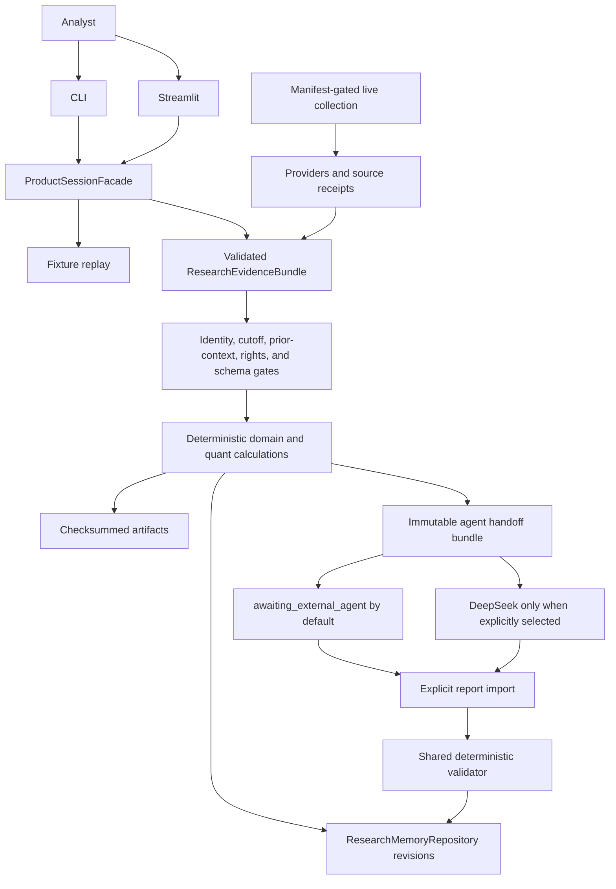

# Current architecture

This page describes the current public source preview, not a proposed target
architecture. EventLens is organized around one product-session service, typed
evidence and artifact contracts, deterministic domain code, and explicit
adapters at the edges.

## System boundary

EventLens owns the event-analysis workflow: request and session identity,
cutoff checks, prior-context eligibility, canonical calculations, schema and
report validation, persistence transitions, artifact checksums, and rendering.
Providers and external reasoning tools supply inputs or semantic proposals;
they do not own EventLens state or canonical calculations.

The diagram separates responsibilities; not every route is an automatic
end-to-end live pipeline. In particular, the collector and the research
session have explicit input/configuration boundaries. The synthetic demo uses
fixtures, not live collection.

## Runtime layers

### Entry points

- `src/eventlens/app/commands.py` parses CLI options and delegates work.
- `src/eventlens/web/streamlit_app.py` and related web modules present
  sessions, status, artifacts, and analyst actions.
- Both use `ProductSessionFacade` for product-session creation, reload, and
  transitions. Presentation adapters do not own canonical calculations or
  independently write product status.

### Product-session service

`src/eventlens/web/product_session.py` provides the repository-backed session
boundary. It handles fixture and live modes, idempotency, status revisions,
artifact references, resume, and explicit handoff/report transitions. The
repository revision is authoritative; local JSON is a checked mirror or
legacy import source.

The fixture mode executes the bundled D0 replay. The live mode accepts a
configured evidence source and returns an explicit ready or blocked state. A
provider-backed collector must first satisfy its own event-manifest,
cutoff, rights, budget, and authorization requirements.

### Evidence and deterministic domain

`src/eventlens/product/research_evidence.py` defines the immutable
`ResearchEvidenceBundle` and validates its structure. It binds target event,
company context, ontology coverage, prior cards, optional evidence components,
source receipts, missingness, and a checksum. It rejects inconsistent
identities, duplicate/dangling receipts, cards that are not approved and
cutoff-eligible, and evidence that is not strictly before the target cutoff.

`src/eventlens/domain/` and `src/eventlens/quant/` own deterministic facts and
financial calculations. Their types retain units, fiscal periods, basis,
sample information, and reasons for unavailable or incomparable results.
Provider adapters do not calculate a canonical result by writing prose.

`src/eventlens/context_cards/` owns historical context card models, builders,
validation, quality rules, and readable rendering. A card’s identity,
knowledge cutoff, status, provenance, and checksum travel with the content.

### External reasoning boundary

`src/eventlens/agents/` owns external bundle/report types, route selection,
validation, and handoff operations. The default route exports an immutable
bundle, writes `awaiting_external_agent`, and stops for human operation. If the
operator explicitly selects the direct DeepSeek route, it uses the same report
validator. A validation or service failure does not trigger an alternate
route.

`src/eventlens/research_engines/` contains the optional Vibe-Trading evidence
adapter. It is a bounded evidence source; it does not own product-session
status or rewrite EventLens metrics.

### Persistence and artifacts

`src/eventlens/memory/` and `src/eventlens/persistence/` define the repository
and record boundaries. Demo/test defaults use local SQLite. A deployment
owner configures its own Supabase project for durable typed records. Large
bundle/report bodies are stored as checksummed artifacts in a private
artifact directory, not duplicated into every session record. A second
machine needs access to that private artifact store as well as the typed
records; shared object storage is not included in this preview.

`src/eventlens/artifacts/` provides artifact envelopes, integrity checks,
fixture replay helpers, and render/export support. JSON is canonical for
machine-readable session and report records; Markdown and Streamlit are
readable views of those records.

## Data flow and authority

For one pre-event analysis:

1. A researcher submits an event research request through the CLI or interface.
2. The session service resolves a fixture or validates the configured evidence
   input. A missing or ineligible prerequisite becomes a typed blocked state.
3. The service checks event identity, cutoff, prior-card eligibility, receipts,
   rights metadata, and schema coherence.
4. Deterministic code calculates canonical metrics and retains their basis,
   source references, and missingness.
5. The session revision records status and immutable artifact references.
6. By default, EventLens exports a typed agent bundle and pauses. A human
   returns a report for explicit import.
7. The same validator checks bundle binding, citation allowlists, cutoff,
   canonical facts, report schema, and policy fields before the next revision.

Authority is intentionally split:

| Concern | Owner |
|---|---|
| Event/cutoff identity, eligibility, timestamps, status, checksums | EventLens deterministic code |
| Canonical financial metrics and units | EventLens deterministic domain/quant code |
| Source retrieval and source-provided facts | Provider adapter, retained with provenance and limitations |
| Materiality, interpretation, narrative, uncertainty | Analyst or bounded agent proposal, subject to review and validation |
| Product-session status and revision | ProductSessionFacade and repository transition contract |
| Human acceptance and any real-world decision | Operator/user |

Model output cannot change canonical facts or transition state until imported
through the validator. A source citation does not prove a claim is correct; a
checksum proves byte identity, not data rights or semantic accuracy.

## Boundaries that must remain visible

- Pre-event evidence and prior context are cutoff-gated; post-event outcomes
  belong to separate retrospective workflows.
- Missingness, incomparable units, degraded data, and provider warnings are
  represented explicitly; unsupported values are not silently substituted.
- Provider data rights and retention rules accompany the receipt and remain
  the operator’s responsibility.
- The external agent is not automatically launched. There is no silent route
  fallback.
- The system performs research workflow operations; no broker or execution
  integration is part of this public preview.
- Learning/evaluation structures are offline/shadow. They do not self-modify
  prompts, policy, or live routing.
- The complete live research, review, QA, outcome, and publication lifecycle
  is not implemented as a turnkey service.

## Compatibility code

`src/eventlens/graph/models.py` remains for the compatibility of stored records
and schemas that still reference graph-shaped model types. The active public
lifecycle does not run a legacy graph engine, graph checkpoint writer, or
graph-specific UI. New lifecycle behavior belongs in the product-session
service and its repository transitions.

## How to continue exploring

- Use the [repository map](guide/repository-map.md) to find the owner of a
  behavior.
- Use the [product model](guide/product-model.md) to trace evidence and
  handoffs.
- Use [product decisions](guide/product-decisions.md) for rationale.
- Use [implementation status](guide/implementation-status.md) to distinguish
  existing components from completed product paths.
- Read [agent runtime](agent-runtime.md), [storage](storage.md), and [web
  interface](web-interface.md) for operator-level detail.
