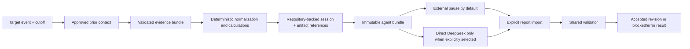

# Product model

This page explains how EventLens represents an event research run and why the
order of its steps matters.

## 1. Identify the event and its cutoff

A run concerns one named issuer event, such as a fiscal-quarter earnings
release. Its identity includes the ticker, event, fiscal period, expected time,
market/calendar context, and the source used to support the schedule. The
information cutoff is the boundary for what may inform a pre-event view.

The cutoff is not merely a timestamp printed on the final report. It is an
eligibility rule applied to evidence, prior context, and calculations. A value
published or available after the cutoff cannot be used as if it were known
before the event. EventLens also preserves uncertainty when a release time is
not known precisely; it does not silently convert an uncertain date into a
known timestamp.

## 2. Establish eligible historical context

Prior context cards summarize earlier company events. The card has its own
event identity, knowledge time, status, evidence lineage, and checksum. The
pre-event request only accepts approved cards for the same ticker that are
strictly earlier than the target event and strictly available before the target
cutoff. The normal gate requires three eligible prior cards. A newly covered
issuer can use a separate, explicit eligibility record with a stated
insufficient-history marker; the system does not disguise a short history as a
full sample.

Historical context is useful as background for a later analyst or agent. It is
not causal proof. A card’s themes, a later stock reaction, and an ensuing event
can be compared, but the comparison does not establish that the themes caused
the price move.

## 3. Build a typed evidence input

The live analysis boundary consumes a `ResearchEvidenceBundle`. The issuer or
collection layer prepares it; the shared research path validates it. The bundle
binds together:

- target-event identity and the information cutoff;
- issuer/company context and ontology coverage;
- eligible prior cards and their receipts;
- optional consensus, management guidance, news, technical, and historical
  analytics components;
- missingness entries for absent or incomplete components;
- source, retrieval, availability, and provenance metadata;
- a canonical checksum.

The validator checks identity, event order, receipt uniqueness, cutoff
eligibility, prior-card approval, source relationships, and consistency among
fields. It rejects post-cutoff evidence, mismatched tickers or events, dangling
provenance, and incomplete missingness. A bundle is an input boundary, not
proof that every listed source is correct or licensed for every use.

## 4. Keep data, calculations, and interpretation separate

EventLens uses code for deterministic rules: parsing and schema validation,
event and cutoff checks, metric arithmetic, comparability rules, checksums,
and state transitions. Those results remain distinguishable from semantic
judgments such as whether a statement is material or what opposing evidence
means.

Source text and provider records are not interchangeable with normalized
facts. A normalized value should retain its period, unit, basis, availability,
method, source reference, and missingness. When a value is absent or
incomparable, the output should say why instead of filling the gap with an
unsupported estimate.

## 5. Create the session and agent boundary

`ProductSessionFacade` is the shared service used by the CLI and Streamlit for
product-session creation, reopening, and transitions. A session records its
mode, origin, status, identity, revision, and artifact references. The
repository owns authoritative revisions; checksum-verified local documents
are mirrors or migration inputs rather than independent status authorities.

When interpretation is requested, the default route creates a versioned,
immutable agent bundle and pauses at `awaiting_external_agent`. EventLens does
not start an outside agent, and no model is invoked on that route. A human
operator takes the bundle to the selected agent, then explicitly imports the
result. The importer checks the returned report against the same bundle,
including identity, canonical facts, citations, cutoff, schema, and policy
fields, before accepting the next revision.

If the external-agent flag is explicitly disabled, the configured DeepSeek
adapter uses the same typed report and validation boundary. A failed external
report does not cause a DeepSeek call, and a failed DeepSeek request does not
switch to another route. Route selection is a configuration decision, not a
best-effort fallback chain.

## 6. Persist references and review the result

Product-session state stores bounded metadata and references rather than raw
article bodies or unrestricted model prompts. Artifact files are written and
checked by content hash. Local SQLite is for demonstrations and tests. A
deployed instance must use its own Supabase project for durable typed records
and must provide private artifact storage for bundle/report bodies. The public
repository has no shared project or credentials.

The analyst can review the session status, deterministic baseline, context,
artifact checksums, citations, warnings, and unavailable stages through the
CLI or local interface. The preview does not complete every live research,
committee, quality-assurance, post-event outcome, or publishing stage. See
[implementation status](implementation-status.md).

## The same-run sequence

This sequence describes the common contract. The synthetic demo is a fixture
replay and does not perform a live collection. The configured live provider
collector is a separate operation with its own timing and authorization gates.
